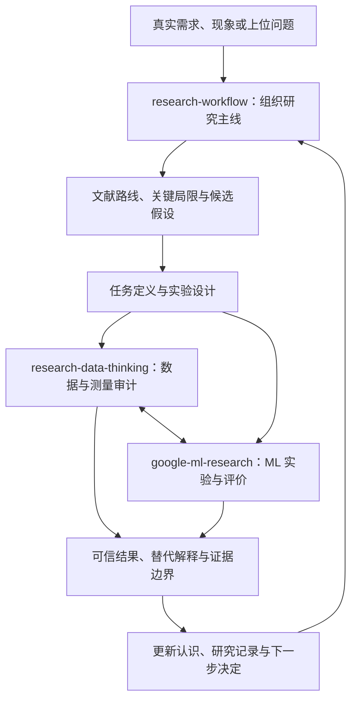

# Research Mindset

把个人科研思维沉淀为可复用、可追溯、持续迭代的 AI skills，让研究问题、数据、方法、实验与结论始终联系在一起。

项目围绕四个问题展开：**我想弄清楚什么？为什么值得研究？什么证据能改变判断？下一步应该做什么？**

## Motivation：为什么建立这个项目

科研过程中，读文献、处理数据、训练模型和整理结果都可能很忙，却没有减少真正重要的不确定性。例如，围绕某个模型积累论文，却没有说明它解决什么关键问题；指标提高了，却没有验证提升来自方法本身；处理流程可以运行，却改变了样本构成或引入测试信息。这些断点会影响研究判断。

这个项目希望把个人科研经验、课堂启发、机器学习课程与数据分析原则，整理成 AI 助手能够按情境使用的思考规则。每次讨论和实验都尽量保留从问题到证据的联系，并让新的经验能够修正原有框架。

项目关注三件事：

- **保持问题主线。** 从真实需求或有意义的上位问题出发，通过文献与分析形成可检验的研究判断，明确研究后希望增加什么认识。
- **提高证据质量。** 同时审视数据如何生成、模型如何比较、评价能支持什么结论，避免把代理指标的改善直接当成科学问题的答案。
- **积累研究过程。** 按需保存文献判断、数据事实、实验预期、实际结果与路线变化，让负面结果和思维演化也可以追溯。

成功的研究推进可以是形成可靠的新解释、澄清成立条件、排除一个解释，或依据证据调整方向。评价一次工作时，既看结果，也看它减少了哪个关键未知。

## 整体架构

仓库由三个可独立使用、相互补充的 skill 构成。`research-workflow` 提供整体研究主线，另外两个模块分别深化 ML 实验判断与数据处理判断。



这张图表达思维上的配合关系。三个 skill 由 AI 助手按当前任务选用，仓库中没有负责自动调度它们的执行程序。实际研究允许从异常、现成数据或新观察出发，再返回问题与假设。

| 模块 | 核心问题 | 主要功能 | 典型产出 |
| --- | --- | --- | --- |
| [research-workflow](skills/research-workflow/SKILL.md) | 为什么做、研究什么、怎样形成完整证据？ | 问题定位、文献综合、gap 分析、跨领域 idea、实验设计、研究主线与阶段判断 | 问题地图、motivation、挑战—创新—证据对应表、实验卡、研究决策 |
| [google-ml-research](skills/google-ml-research/SKILL.md) | ML 目标和评价是否真正回应研究问题？ | 目标与代理对齐、简单基线、公平比较、泛化评价、区分性实验、失败诊断与复盘 | ML 研究卡、比较方案、诊断路径、继续或修改方法的依据 |
| [research-data-thinking](skills/research-data-thinking/SKILL.md) | 数据代表什么，处理后还能支持什么判断？ | 来源与单位核验、质量审计、多来源整合、处理语义、异常调查、抽样与独立划分 | 数据事实卡、处理决策账本、样本流失表、异常解释与核验方案 |

### research-workflow：连接研究问题与知识增量

围绕上位问题比较已有研究路线，分析反复出现的局限及其成立条件，再形成具体研究问题、假设与方法。借鉴跨领域思路时，说明可迁移的机制、所依赖的前提和需要检验的差异。

推进过程中区分问题层、任务层和实验层，检查每项挑战是否有对应方法与证据。通过简短的 research highlight 保持 motivation、关键结果及其意义清楚可见；依据证据判断当前阶段和最有价值的下一步。

需要记录时，使用项目、文献、数据、实验和决策模板。记录保留事前预期与事后结果，帮助后续讨论、课题续接及研究表达。

### google-ml-research：让 ML 实验产生可解释的证据

从现象与目标出发，检查“真实目标 → 代理标签 → 训练目标 → 评价 → 科学主张”之间是否存在断点。先建立可信基线与可运行的最小流程，再判断模型复杂度是否必要。

实验围绕竞争解释展开：改变什么、保持什么可比、预期看到什么、不同结果将改变哪个决定。失败时沿数据、预处理、训练、模型选择与评价定位问题，结合误差分组和不确定性判断下一项检查。

该模块借鉴 Google 四门机器学习基础课程，并将其中的实践原则改写为科研情境下的判断方式；具体映射见 [课程来源与适用边界](skills/google-ml-research/references/course-principles.md)。

### research-data-thinking：把数据处理作为科学选择

从数据来源、采集目的、测量协议与记录单位开始，区分记录数、派生样本数与独立对象数。对筛选、连接、去重、填补、信号变换和标签构造，说明目的、依据、对象构成变化及可能影响。

异常首先触发调查：检查代码、单位、连接和分母，再比较测量问题、选择效应与真实差异等解释。数据划分匹配希望推广到的对象、时间、来源或场景；学习得到的预处理参数在训练部分内拟合，避免评价信息进入方法选择。

## 数据收集、实验设计与模型的关系

数据如何收集，决定模型能够接触哪些信息，也约束最后可以作什么推断。因此，研究设计需要同时考虑目标人群、独立单位、测量时点、标签来源、比较条件与推广范围。

例如，假设目标是验证 EEG 模型对新受试者的泛化：同一受试者的许多窗口提供了更多记录，但不能直接等同于更多独立受试者。如果采集设备与组别重合，模型也可能利用设备差异完成预测。此时，采样覆盖、元数据、比较设计和按受试者划分，会共同影响结果的解释。

在这类任务中，`research-workflow` 明确推断目标与采集设计，`research-data-thinking` 核验实际测量、样本关系和处理过程，`google-ml-research` 检查训练与评价是否支持目标主张。EEG 是可选示例，框架也适用于其他 ML、表格、日志和信号研究。

## 如何使用

将所需 skill 的完整目录安装到支持 `SKILL.md` 的 AI 助手技能目录中，保留内部的 `references/`、`assets/` 与 `agents/`。例如，Codex 用户技能目录通常为 `~/.codex/skills/`；本仓库不会自动同步安装目录。

可以直接指定一个模块，并提供当前问题、已有证据和约束：

```text
请用 $research-workflow 梳理这个课题：上位问题是什么，
已有路线回答了哪些部分，当前 gap 还有哪些证据需要核实？
```

```text
请用 $google-ml-research 审视这组实验：
提升可能来自哪些解释，下一项最小实验应当区分什么？
```

```text
请用 $research-data-thinking 审计这份数据处理方案：
独立单位、标签生成、样本排除和数据划分是否支持预期结论？
```

一个课题也可以按需结合三个模块：先明确问题与假设，再核验数据和测量，设计能区分解释的比较，最后根据结果更新主张与研究记录。简单概念解释只需使用相关部分。

课题需要落盘记录时，`research-workflow` 提供以下默认组织方式；已有项目优先复用原有结构，只创建当前需要的文件：

```text
research/
├── PROJECT.md          # 研究主线、当前判断与下一步
├── literature.md       # 文献证据与路线综合
├── data.md             # 数据来源、测量和使用边界
├── experiments/
│   └── E001.md         # 事前假设、设计、实际结果与解释
└── decisions.md        # 证据引起的路线或假设变化
```

## 仓库结构

```text
research-mindset/
├── README.md
├── AGENTS.md                    # 维护范围与逐版本提交规则
├── manifest.json                # 当前 skill 文件的 SHA-256 与来源
├── version-history.json         # research-workflow 历史提交索引
└── skills/
    ├── research-workflow/
    │   ├── SKILL.md             # 工作入口与研究推进规则
    │   ├── references/          # 问题框架、文献、ML、实验设计与表达
    │   ├── assets/templates/    # 项目、文献、数据、实验与决策模板
    │   └── agents/              # 技能展示元数据
    ├── google-ml-research/
    │   ├── SKILL.md
    │   ├── references/          # Google 课程原则与 EEG 迁移示例
    │   └── agents/
    └── research-data-thinking/
        ├── SKILL.md
        ├── references/          # 决策工作表、来源依据与信号迁移
        └── agents/
```

## 设计原则与来源

三个模块共同遵守以下原则：

- **事实、解释与计划分开。** 未执行的检查是方案，未核实的判断保留假设状态，结果与引用回到实际来源。
- **证据与主张匹配。** 分别判断训练收敛、泛化能力与科研假设；结合效应、不确定性、替代解释及适用范围解释结果。
- **保留反证与修改过程。** 负面结果、失败和偏离同样进入研究判断；路线可以根据可靠证据调整。
- **按需使用。** 复用现有资料与记录，把精力放在会改变决定的关键未知上。

方法来源包括个人科研思维整理、对课堂方法论的批判性提炼、Google 官方 ML 基础课程，以及数据分析文章、课程和书籍的选定内容。课堂启发经过整理与边界检查；Google 课程原则与本项目的科研迁移分别说明。这是个人方法论项目。详细依据可查看 [research-workflow 入口](skills/research-workflow/SKILL.md)、[Google 课程映射](skills/google-ml-research/references/course-principles.md)及[数据思维来源](skills/research-data-thinking/references/source-basis.md)。

Skills 提供思考、规划、记录与审计规则。实际检索、数据处理和训练依赖助手可用工具、项目材料及相应运行环境；本仓库本身没有内置训练执行服务。原始课堂录音、PDF、凭据及其他第三方 skills 不纳入仓库。

## 版本管理

**每个实际保存的 skill 版本单独创建一个 commit。** research-workflow 的版本继续提交到同一路径，通过 commit 与标签查看历史，避免把不同版本合并在一次提交中。修改 skill 内容时同步 `manifest.json`；README 等说明性更新可以单独提交。

research-workflow 的前三个历史快照已分别导入；第四版明确补充了深入理解原理与理论的原则。`snapshot-1/2/3/4` 是仓库快照编号，前三次提交记录的是导入时间，不代表最初编写时间。其他两个 skill 各找到一个当前版本。

| 快照 | 内容 | Commit |
| --- | --- | --- |
| snapshot-1 | 整合前工作区快照 | [`a459f73`](https://github.com/fanniuzhan/research-mindset/commit/a459f730ffa4c0cf76e83ad4f104a5467f969542) |
| snapshot-2 | 整合前安装快照 | [`eeb72d7`](https://github.com/fanniuzhan/research-mindset/commit/eeb72d78798e9a54332b16d496da9f6b753671ff) |
| snapshot-3 | 课堂方法与实验设计整合快照 | [`9edf87d`](https://github.com/fanniuzhan/research-mindset/commit/9edf87d2b9d7f94bb18e6d1133bf10edcd65a251) |
| snapshot-4 | 明确原理、理论依据、假设与边界的理解原则 | [`1fd039c`](https://github.com/fanniuzhan/research-mindset/commit/1fd039cf4f93d64e285513bb3963742d939c90e8) |

可通过对应的 `research-workflow-snapshot-1/2/3/4` 标签浏览完整目录，或查看某个历史文件：

```bash
git show <commit>:skills/research-workflow/SKILL.md
```

完整提交索引保存在 [version-history.json](version-history.json)，当前文件校验清单见 [manifest.json](manifest.json)。
